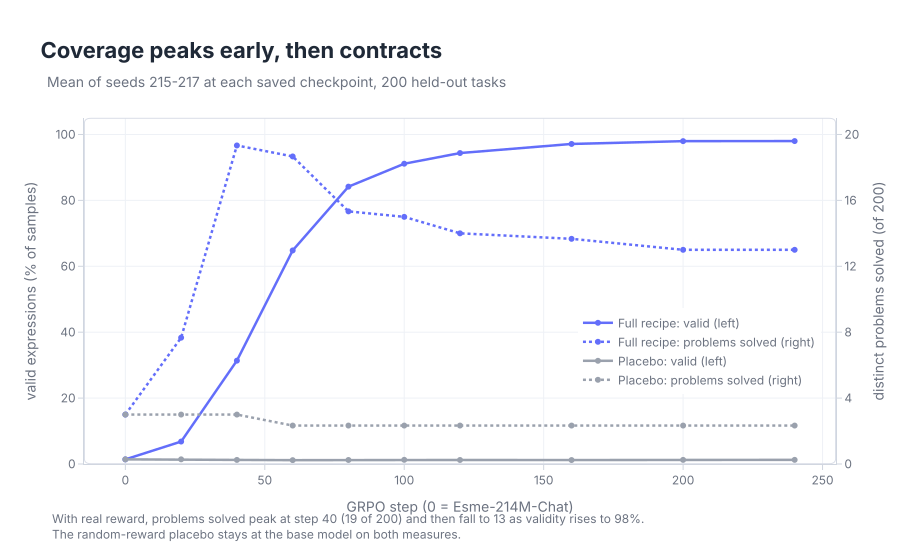
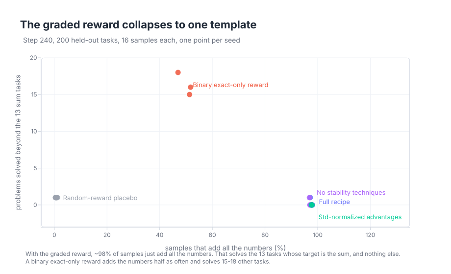
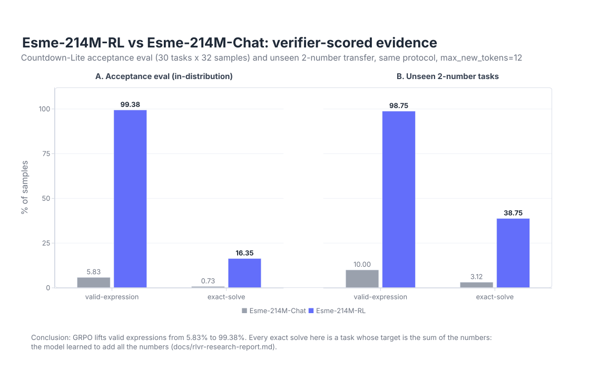

# esme-posttrain

 

Esme is a 214M-parameter language model built from scratch in [`esme-pretrain`](https://github.com/adamthuvesen/esme-pretrain). `esme-posttrain` adapts an `Esme-214M-Base` checkpoint into instruction-following, preference-tuned, and verifier-trained model artifacts.

The standard post-training path has three stages:

```text
Esme-214M-Base
  -> SFT:  Esme-214M-Instruct
  -> DPO:  Esme-214M-Chat
  -> RLVR: Esme-214M-RL
```

RLVR uses GRPO on the current Countdown-Lite verifier task.

The training code uses the repo's dense `torch` backbone directly, without `trl`
or a `transformers` trainer in the loop. The stage objectives are small enough
to inspect in the repo: SFT for chat format, DPO against a frozen SFT reference,
and GRPO against verifier rewards.

## Research Findings

[What GRPO Teaches a 214M Model on Countdown](docs/rlvr-research-report.md) is the
main result. Six real-reward GRPO seeds were compared with six random-reward placebo
seeds at the same training step, on 200 fresh held-out tasks:

- **The reward signal produces the gain.** Valid expressions rise from 1.3% to 97.9%
  (`+96.6 pp`, 95% CI `[+95.9, +97.3]`, sign-flip `p = 0.031`). Problems solved rise
  from 1.2% to 6.6% (`+5.4 pp`, CI `[+2.2, +9.0]`). The placebo does not move.
- **Coverage peaks early, then contracts.** Distinct problems solved peak at step 40
  (19 of 200) and fall to 13 by step 240, while per-sample accuracy keeps rising. All
  six seeds converge on the same 13 problems.
- **The reward shape controls the tradeoff.** A binary exact-only reward is valid only
  59% of the time but solves 28 problems, more than twice the graded reward. Removing
  the stability techniques or switching to std-normalized advantages changes nothing.
- **RL sharpens what the base model can reach.** RL leads pass@k up to k = 64. At
  k = 256 the base model solves 14.0% of tasks and the RL model 9.5%.

<p>
  
</p>
<p>
  
</p>

The report also records the errors this audit found and fixed in earlier versions of
the result: an impossible confidence interval, checkpoint selection on noise, a
mislabeled model, and evaluations that silently ran on the CPU.

## Stage Summary

| Stage | Starts from | Produces | Accepted signal |
| --- | --- | --- | --- |
| SFT | `Esme-214M-Base` | `Esme-214M-Instruct` | Held-out response loss bottoms cleanly, no collapse ([run card](run_cards/esme-214m-sft-multiturn.md)). |
| DPO | `Esme-214M-Instruct` | `Esme-214M-Chat` | Held-out preference accuracy climbs then plateaus ([run card](run_cards/esme-214m-chat-dpo.md)). |
| RLVR | `Esme-214M-Chat` | `Esme-214M-RL` | Verifier reward makes Countdown outputs valid much more often, with a smaller exact-solve lift ([run card](run_cards/esme-214m-rl.md)). |

SFT teaches chat format, turn-taking, and basic instruction following. DPO
trains the model to prefer chosen answers over rejected answers, without
on-policy RL. RLVR then trains against verifier-backed rewards on one task.
The SFT path handles both single-turn instruction rows and longer conversations
through one conversation format; a single-turn row is simply a two-message chat.

The current RLVR target is Countdown-Lite: generate a short arithmetic
expression that uses each supplied number exactly once and reaches the target.
The reward is verifier-backed. Style rewards are out of scope.

## Why 214M?

Esme-214M is small enough to make the full LLM lifecycle practical to build and inspect. Iteration stays cheaper, failures are easier to diagnose, and the project still goes through real training, evaluation, export, post-training, and inference.

## What Is Here

- Stage code for SFT, DPO, RLVR, launch validation, versioned dense-bundle export,
  and shared artifact writing.
- Configs for the current Esme-214M post-training path, validated in code by the stage launch modules.
- Evidence docs for SFT, DPO, completed Countdown-Lite GRPO, and the
  six-seed RLVR decomposition.
- Export tooling for `Esme-214M-Chat` bundles.
- Hashed study specifications that rebuild accepted JSON and Markdown reports.
- A no-spend CPU acceptance path across SFT, DPO resume, RLVR, export, load,
  generation, and verifier scoring.

## Quickstart

```bash
uv sync --extra dev
uv run esme-posttrain --version
make check
```

Use `uv run ...` for Python commands. Default local commands do not download
remote datasets, start private training jobs, or spend money.

Check a bundle without creating a model, rebuild the accepted placebo report,
or run the full local stage chain:

```bash
uv run esme-posttrain bundle-check --bundle-dir fixtures/tiny_bundle --json
uv run esme-posttrain study-report --study studies/rlvr-placebo.json
uv run esme-posttrain full-path-cpu-smoke --output-dir runs/full-path-cpu-smoke --json
```

## Current Artifacts

- `docs/rlvr-research-report.md` is the research report: placebo study, learning
  curves, stability ablations, pass@k, and the audit corrections.
- `studies/rlvr-placebo-step240-large.json` and `studies/rlvr-ablation-*.json` pin the
  200-task studies by hash. Their reports sit beside them, and
  `studies/rlvr-research-summary.json` holds every number the figures use.
- `docs/rlvr-countdown-lite.md` describes the RLVR task, baseline, and result.
- `docs/rlvr-countdown-lite-grpo.md` summarizes the completed Countdown-Lite GRPO run.
- `docs/rlvr-countdown-heldout-transfer.md` scores the RL and pre-RL checkpoints on held-out Countdown sets.
- `run_cards/esme-214m-rl.md` records a placebo-controlled decomposition (via
  [`grpo-decomp`](https://github.com/adamthuvesen/grpo-decomp)) comparing the
  six-seed real-reward gain with a same-budget random-reward placebo.
- Generated export bundles are written under gitignored `exports/`.
- Generated run reports are written under gitignored `artifacts/`.
- `studies/rlvr-placebo.json` pins the six-seed study inputs by hash; its
  generated JSON and Markdown reports are checked in beside it.

## Verifier Evidence

**Reading note:** This chart shows narrow verifier-scored Countdown-Lite
behavior, not broad capability. The strongest signal is valid-expression
transfer; exact solving improves too, but more modestly.
<p>
  
</p>

This figure is rendered by `scripts/plot_run_telemetry.py` from the accepted run
artifacts.

## Repository Layout

```text
src/esme_posttrain/
  cli/                command-line entry point (parser + one module per command group)
  studies/            hashed study specifications and report generation
  bundle.py           dense backbone bundle loading and hashing
  modeling.py         shared dense model primitives
  run_artifacts.py    shared JSON/environment/manifest artifact writers
  sft/                supervised fine-tuning stage
  dpo/                preference-tuning stage
  rl/                 verifier-reward RL stage
  launch/             shared launch validation and cross-stage CPU acceptance
  training/           shared training runtime (collate, metrics, checkpointing)
  export/             dense bundle export
```

Stage-specific code belongs in the stage package. Keep the package root small.
[`docs/architecture.md`](docs/architecture.md) maps how the stages, shared
runtime, and artifact handoffs connect.
The canonical cross-repo bundle contract and compatibility policy live in
[`esme-pretrain/docs/bundle-format.md`](https://github.com/adamthuvesen/esme-pretrain/blob/main/docs/bundle-format.md).

## Related Repositories

These repositories exchange artifacts, not imports:

- [`esme-pretrain`](https://github.com/adamthuvesen/esme-pretrain): trains
  `Esme-214M-Base` from scratch.
- [`esme-posttrain`](https://github.com/adamthuvesen/esme-posttrain): adapts
  the base checkpoint with SFT, DPO, and verifier-backed RLVR.
- [`llm-infer`](https://github.com/adamthuvesen/llm-infer): loads, serves, and
  benchmarks exported Esme checkpoints.
- [`llm-rlvr`](https://github.com/adamthuvesen/llm-rlvr): provides a reusable
  RLVR harness with text-to-SQL as the reference task.
- [`grpo-decomp`](https://github.com/adamthuvesen/grpo-decomp): measures where
  GRPO gains come from, separating reliability from new capability.

The [full-lifecycle retrospective](https://github.com/adamthuvesen/esme-pretrain/blob/main/docs/retrospective.md)
walks the whole chain, with every claim linked to a committed artifact.

## References

- Lambert et al., [_Tulu 3: Pushing Frontiers in Open Language Model Post-Training_](https://arxiv.org/abs/2411.15124), 2025.
- Chung et al., [_Scaling Instruction-Finetuned Language Models_](https://arxiv.org/abs/2210.11416), 2022.
- Rafailov et al., [_Direct Preference Optimization_](https://arxiv.org/abs/2305.18290), 2023.
- Shao et al., [_DeepSeekMath: Pushing the Limits of Mathematical Reasoning in Open Language Models_](https://arxiv.org/abs/2402.03300), 2024.
- Guo et al., [_DeepSeek-R1: Incentivizing Reasoning Capability in LLMs via Reinforcement Learning_](https://arxiv.org/abs/2501.12948), 2025.
- Wen et al., [_Reinforcement Learning with Verifiable Rewards Implicitly Incentivizes Correct Reasoning in Base LLMs_](https://arxiv.org/abs/2506.14245), 2025.
